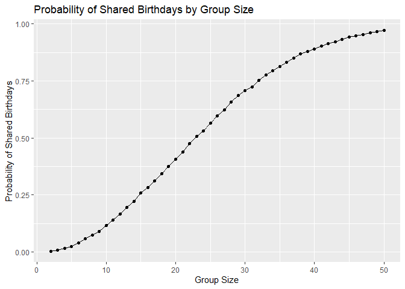

P8105 Homework 5
================
Yutong

# Problem 1

``` r
set.seed(123)

birthday_sim = function(n) {
  birthdays = sample(1:365, size = n, replace = TRUE)
  any(duplicated(birthdays))
}

birthday_probability = function(n) {
  results = map_lgl(1:10000, ~ birthday_sim(n))
  mean(results)
}

birthday_df = tibble(
  group_size = 2:50,
  probability = map_dbl(group_size, birthday_probability)
)

ggplot(birthday_df, aes(x = group_size, y = probability)) +
  geom_line() +
  geom_point() +
  labs(
    title = "Probability of Shared Birthdays by Group Size",
    x = "Group Size",
    y = "Probability of Shared Birthdays"
  )
```

<!-- -->

As the group size increases, the probability of sharing a birthday also
increases. When there are more than 50 people, the probability is almost
100%. It is more likely that two people share a birthday that we might
expect.
