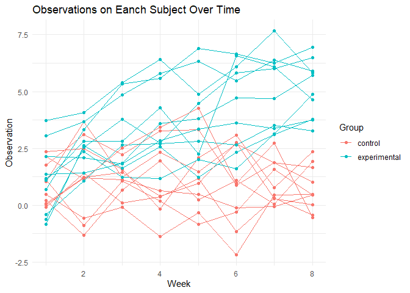
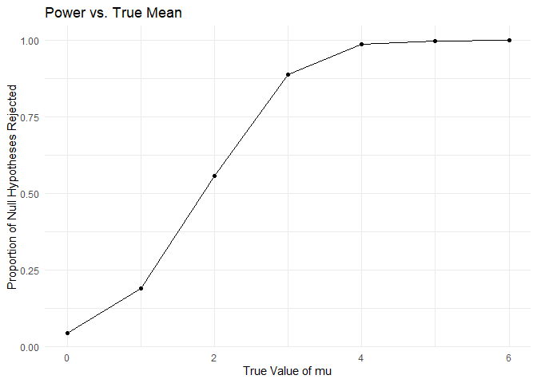
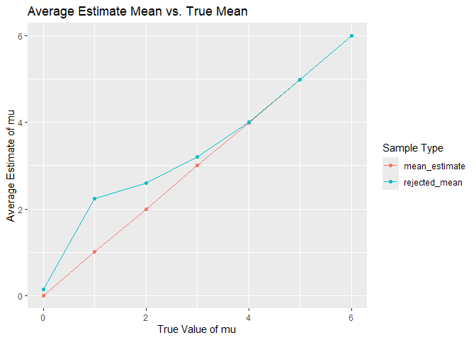

P8105 Homework 5
================
Yutong

# Problem 1

``` r
set.seed(123)

birthday_sim = function(n) {
  birthdays = sample(1:365, size = n, replace = TRUE)
  any(duplicated(birthdays))
}

birthday_probability = function(n) {
  results = map_lgl(1:10000, ~ birthday_sim(n))
  mean(results)
}

birthday_df = tibble(
  group_size = 2:50,
  probability = map_dbl(group_size, birthday_probability)
)

ggplot(birthday_df, aes(x = group_size, y = probability)) +
  geom_line() +
  geom_point() +
  labs(
    title = "Probability of Shared Birthdays by Group Size",
    x = "Group Size",
    y = "Probability of Shared Birthdays"
  )
```

<!-- -->

As the group size increases, the probability of sharing a birthday also
increases. When there are more than 50 people, the probability is almost
100%. It is more likely that two people share a birthday that we might
expect.

# Problem 2

``` r
files_df = tibble(
  file_name = list.files("data", pattern = "\\.csv$")
)

files_df 
```

    ## # A tibble: 20 × 1
    ##    file_name 
    ##    <chr>     
    ##  1 con_01.csv
    ##  2 con_02.csv
    ##  3 con_03.csv
    ##  4 con_04.csv
    ##  5 con_05.csv
    ##  6 con_06.csv
    ##  7 con_07.csv
    ##  8 con_08.csv
    ##  9 con_09.csv
    ## 10 con_10.csv
    ## 11 exp_01.csv
    ## 12 exp_02.csv
    ## 13 exp_03.csv
    ## 14 exp_04.csv
    ## 15 exp_05.csv
    ## 16 exp_06.csv
    ## 17 exp_07.csv
    ## 18 exp_08.csv
    ## 19 exp_09.csv
    ## 20 exp_10.csv

``` r
files_df = files_df |> 
  mutate(
    data = map(file_name, ~ read_csv(file.path("data", .x), show_col_types = FALSE))
  )

files_df
```

    ## # A tibble: 20 × 2
    ##    file_name  data              
    ##    <chr>      <list>            
    ##  1 con_01.csv <spc_tbl_ [1 × 8]>
    ##  2 con_02.csv <spc_tbl_ [1 × 8]>
    ##  3 con_03.csv <spc_tbl_ [1 × 8]>
    ##  4 con_04.csv <spc_tbl_ [1 × 8]>
    ##  5 con_05.csv <spc_tbl_ [1 × 8]>
    ##  6 con_06.csv <spc_tbl_ [1 × 8]>
    ##  7 con_07.csv <spc_tbl_ [1 × 8]>
    ##  8 con_08.csv <spc_tbl_ [1 × 8]>
    ##  9 con_09.csv <spc_tbl_ [1 × 8]>
    ## 10 con_10.csv <spc_tbl_ [1 × 8]>
    ## 11 exp_01.csv <spc_tbl_ [1 × 8]>
    ## 12 exp_02.csv <spc_tbl_ [1 × 8]>
    ## 13 exp_03.csv <spc_tbl_ [1 × 8]>
    ## 14 exp_04.csv <spc_tbl_ [1 × 8]>
    ## 15 exp_05.csv <spc_tbl_ [1 × 8]>
    ## 16 exp_06.csv <spc_tbl_ [1 × 8]>
    ## 17 exp_07.csv <spc_tbl_ [1 × 8]>
    ## 18 exp_08.csv <spc_tbl_ [1 × 8]>
    ## 19 exp_09.csv <spc_tbl_ [1 × 8]>
    ## 20 exp_10.csv <spc_tbl_ [1 × 8]>

``` r
files_df = files_df |> 
  mutate(
    arm = if_else(str_detect(file_name, "^con"), "control", "experimental"),
    subject_id = str_extract(file_name, "\\d+")
  )

files_df
```

    ## # A tibble: 20 × 4
    ##    file_name  data               arm          subject_id
    ##    <chr>      <list>             <chr>        <chr>     
    ##  1 con_01.csv <spc_tbl_ [1 × 8]> control      01        
    ##  2 con_02.csv <spc_tbl_ [1 × 8]> control      02        
    ##  3 con_03.csv <spc_tbl_ [1 × 8]> control      03        
    ##  4 con_04.csv <spc_tbl_ [1 × 8]> control      04        
    ##  5 con_05.csv <spc_tbl_ [1 × 8]> control      05        
    ##  6 con_06.csv <spc_tbl_ [1 × 8]> control      06        
    ##  7 con_07.csv <spc_tbl_ [1 × 8]> control      07        
    ##  8 con_08.csv <spc_tbl_ [1 × 8]> control      08        
    ##  9 con_09.csv <spc_tbl_ [1 × 8]> control      09        
    ## 10 con_10.csv <spc_tbl_ [1 × 8]> control      10        
    ## 11 exp_01.csv <spc_tbl_ [1 × 8]> experimental 01        
    ## 12 exp_02.csv <spc_tbl_ [1 × 8]> experimental 02        
    ## 13 exp_03.csv <spc_tbl_ [1 × 8]> experimental 03        
    ## 14 exp_04.csv <spc_tbl_ [1 × 8]> experimental 04        
    ## 15 exp_05.csv <spc_tbl_ [1 × 8]> experimental 05        
    ## 16 exp_06.csv <spc_tbl_ [1 × 8]> experimental 06        
    ## 17 exp_07.csv <spc_tbl_ [1 × 8]> experimental 07        
    ## 18 exp_08.csv <spc_tbl_ [1 × 8]> experimental 08        
    ## 19 exp_09.csv <spc_tbl_ [1 × 8]> experimental 09        
    ## 20 exp_10.csv <spc_tbl_ [1 × 8]> experimental 10

``` r
longitudinal_df = files_df |> 
  unnest(cols = data) |> 
  pivot_longer(
    cols = starts_with("week"),
    names_to = "week",
    values_to = "observation"
  ) |> 
  mutate(
    week = as.numeric(str_extract(week, "\\d+"))
  )

longitudinal_df
```

    ## # A tibble: 160 × 5
    ##    file_name  arm     subject_id  week observation
    ##    <chr>      <chr>   <chr>      <dbl>       <dbl>
    ##  1 con_01.csv control 01             1        0.2 
    ##  2 con_01.csv control 01             2       -1.31
    ##  3 con_01.csv control 01             3        0.66
    ##  4 con_01.csv control 01             4        1.96
    ##  5 con_01.csv control 01             5        0.23
    ##  6 con_01.csv control 01             6        1.09
    ##  7 con_01.csv control 01             7        0.05
    ##  8 con_01.csv control 01             8        1.94
    ##  9 con_02.csv control 02             1        1.13
    ## 10 con_02.csv control 02             2       -0.88
    ## # ℹ 150 more rows

``` r
longitudinal_df |> 
  ggplot(
    aes(
      x = week,
      y = observation,
      group = interaction(arm, subject_id),
      color = arm
    )
  ) +
  geom_line() +
  geom_point() +
  labs(
    title = "Observations on Eanch Subject Over Time",
    x = "Week",
    y = "Observation",
    color = "Group"
  ) +
  theme_minimal()
```

<!-- -->

The experimental group shows a stronger overall upward trend than the
control group. The difference between the groups becomes more noticeable
in later weeks.

# Problem 3

``` r
sim_t_test = function(mu) {
  data = rnorm(n = 30, mean = mu, sd = 5)
  test = t.test(data, mu = 0)
  broom::tidy(test) |> 
    select(estimate, p.value)
}
```

``` r
set.seed(123)

sim_results = tibble(
  mu = 0:6
) |> 
  mutate(
    results = map(mu, ~ map_dfr(1:5000, \(x) sim_t_test(.x)))
  ) |> 
  unnest(results)

sim_results
```

    ## # A tibble: 35,000 × 3
    ##       mu estimate p.value
    ##    <int>    <dbl>   <dbl>
    ##  1     0  -0.236   0.794 
    ##  2     0   0.892   0.252 
    ##  3     0   0.122   0.879 
    ##  4     0  -0.469   0.575 
    ##  5     0  -0.918   0.388 
    ##  6     0   0.769   0.379 
    ##  7     0   0.0735  0.934 
    ##  8     0  -0.448   0.578 
    ##  9     0   0.254   0.789 
    ## 10     0   1.68    0.0483
    ## # ℹ 34,990 more rows

``` r
power_df = sim_results |> 
  group_by(mu) |> 
  summarize(
    power = mean(p.value < 0.05)
  )

power_df
```

    ## # A tibble: 7 × 2
    ##      mu  power
    ##   <int>  <dbl>
    ## 1     0 0.0446
    ## 2     1 0.191 
    ## 3     2 0.556 
    ## 4     3 0.890 
    ## 5     4 0.987 
    ## 6     5 0.999 
    ## 7     6 1

``` r
ggplot(power_df, aes(x = mu, y = power)) +
  geom_line() +
  geom_point() +
  labs(
    title = "Power vs. True Mean",
    x = "True Value of mu",
    y = "Proportion of Null Hypotheses Rejected"
  ) +
  theme_minimal()
```

<!-- -->

As the effect size increases, the power of the test increases. When the
true mean is close to 0, the power is low. As the true mean increases,
the power increases and approaches 1.

``` r
rejected_df = sim_results |>
  filter(p.value < 0.05) |> 
  group_by(mu) |> 
  summarize(
    rejected_mean = mean(estimate)
  )

rejected_df
```

    ## # A tibble: 7 × 2
    ##      mu rejected_mean
    ##   <int>         <dbl>
    ## 1     0         0.147
    ## 2     1         2.23 
    ## 3     2         2.60 
    ## 4     3         3.20 
    ## 5     4         4.01 
    ## 6     5         4.99 
    ## 7     6         5.99

``` r
mean_df = sim_results |> 
  group_by(mu) |> 
  summarize(
    mean_estimate = mean(estimate)
  )

mean_df
```

    ## # A tibble: 7 × 2
    ##      mu mean_estimate
    ##   <int>         <dbl>
    ## 1     0       0.00900
    ## 2     1       1.01   
    ## 3     2       1.99   
    ## 4     3       3.01   
    ## 5     4       3.98   
    ## 6     5       4.98   
    ## 7     6       5.99

``` r
comparison_df = mean_df |> 
  left_join(rejected_df, by = "mu")

comparison_df
```

    ## # A tibble: 7 × 3
    ##      mu mean_estimate rejected_mean
    ##   <int>         <dbl>         <dbl>
    ## 1     0       0.00900         0.147
    ## 2     1       1.01            2.23 
    ## 3     2       1.99            2.60 
    ## 4     3       3.01            3.20 
    ## 5     4       3.98            4.01 
    ## 6     5       4.98            4.99 
    ## 7     6       5.99            5.99

``` r
comparison_df |> 
  pivot_longer(
    cols = c(mean_estimate, rejected_mean),
    names_to = "type",
    values_to = "average_estimate"
  ) |> 
  ggplot(aes(x = mu, y = average_estimate, color = type)) +
  geom_line() +
  geom_point() +
  labs(
    title = "Average Estimate Mean vs. True Mean",
    x = "True Value of mu",
    y = "Average Estimate of mu",
    color = "Sample Type"
  )
```

<!-- -->

No, not always equal. When the true mean is small and positive, the
average estimate among samples that reject the null hypothesis is higher
than the true mean. This is because samples with larger estimated
effects are more likely to produce statistically significant results.
With the true mean increases, the difference becomes smaller because the
power approaches 1.
